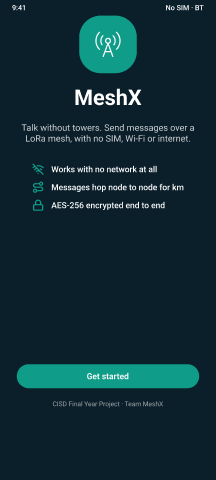
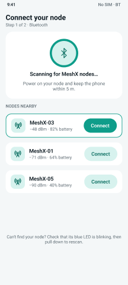
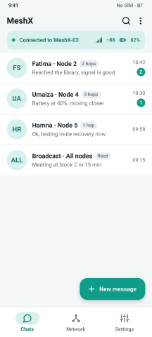
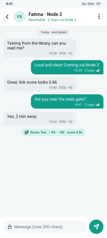
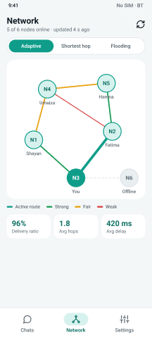
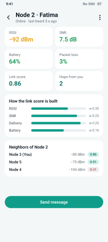
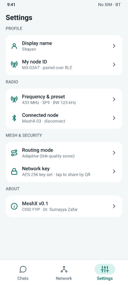

# Android app UI/UX design (v0.1)

- **Figma design file (screens, components, style guide):** https://www.figma.com/design/AcwXg0kupgabqYOPDhirem
- **FigJam user flow + system schematic:** https://www.figma.com/board/8ZKwC6RBukY7y6MXb6kNz0

Phone frame: 360 × 800 dp (standard Android). Font: Roboto. Colours: teal `#0F9D8A` for "connected / mesh",
navy `#0B1F2A` for the off-grid identity. All colours are Figma variables (collection "MeshX Colors") and the
same values are in `android-app/.../ui/theme/Theme.kt`.

## User flow

```
Open app → first launch? → 01 Welcome → 02 Connect node (BLE scan) → 03 Chats
03 Chats → tap chat / New message → 04 Chat → Send → phone → BLE → node → LoRa hops → ACK back (✓✓)
03 Chats → Network tab → 05 Network map → tap node → 06 Node details → Send message → 04 Chat
Any tab → 07 Settings
```

## Screens

| # | Screen | Why it exists (maps to proposal objective) | Preview |
|---|---|---|---|
| 01 | Welcome | Explains the off-grid idea in one line |  |
| 02 | Connect node | Pair the phone with its nearest node over BLE |  |
| 03 | Chats | Conversations, hop count per contact, broadcast channel, connected-node status |  |
| 04 | Chat | Send/receive, delivery status (✓ sent, ✓✓ ACK), hops, RSSI, route used |  |
| 05 | Network map | Live topology, link quality colours, routing mode switch (adaptive / shortest hop / flooding), PDR and delay |  |
| 06 | Node details | RSSI, SNR, battery, loss, link score breakdown, neighbours |  |
| 07 | Settings | Name, node ID, radio preset, network key, demo mode |  |

Reusable components (Figma "Components" board): Bottom Nav (3 variants), Chat Row, Bubble/Out, Bubble/In,
Node Status Bar. See `screens/components.png`.

## Design decisions

1. **Signal info is always visible** (hops, RSSI, ✓/✓✓) because proving multi-hop delivery is the point of the demo.
2. **Routing mode switch on the Network tab** lets us run the adaptive vs shortest-hop vs flooding comparison live.
3. **Demo mode** (Settings) shows a fake 6-node mesh so the app can be presented before all hardware is built.
4. **Broadcast channel** (node 255) for emergency-style "message everyone".
5. Large touch targets (48 dp) and high contrast for outdoor/disaster use.

## Ideas for v0.2

SOS button with GPS location, message retry button on ⚠, QR code to share the network key, dark theme for night use.
